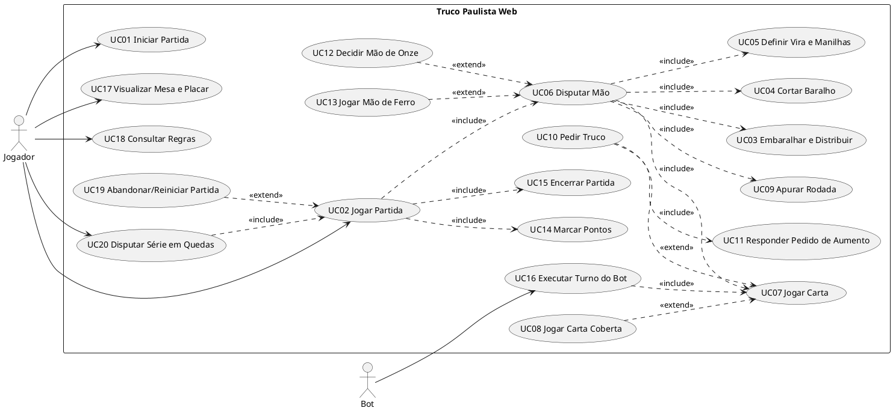

# Truco Paulista Web — Especificação de Casos de Uso

> Sistema web em que **1 jogador humano** joga Truco Paulista contra **3 bots** (1 bot parceiro + 2 bots adversários), em 2 duplas.

---

## 0. Revisão do caso de uso original (`UC — PartidaTruco`)

| # | Problema encontrado | Correção aplicada |
|---|---|---|
| 1 | Mistura os conceitos de **rodada**, **mão** e **partida** ("ganhou a rodada" no passo 5 e "ganha a partida" na pós-condição). | Glossário (seção 2) e separação em casos de uso diferentes: Jogar Partida (UC02) → Disputar Mão (UC06) → Jogar Carta/Rodada (UC07). |
| 2 | Objetivo "poder conseguir vencer a partida" descreve um desejo, não o que o ator faz no sistema. | Objetivo: "Jogar uma partida completa até que uma dupla atinja 12 pontos". |
| 3 | Pré-condição "ser cadastrado na partida": o sistema não tem cadastro. | Pré-condição: "Partida iniciada (UC01) com as 4 posições ocupadas". |
| 4 | Passos 1 a 3 têm como ator "o jogador do pé" e "o jogador da direita", mas na maioria das mãos quem embaralha e corta é um **bot**. | Os passos viram responsabilidade de quem ocupa a posição (humano ou bot), descrita em UC03 e UC04. |
| 5 | O corte foi atribuído ao jogador da **direita**. Pelas regras, o corte é feito pelo **adversário à esquerda** de quem embaralha. | Corrigido na RN06. |
| 6 | Faltam a **vira** e as **manilhas**, que definem a força das cartas em toda mão. | Novo UC05 – Definir Vira e Manilhas. |
| 7 | Passo 4 "O jogador deve permitir jogar": quem permite é o **sistema**, e o jogador **joga** a carta. | Passos reescritos alternando "Ator faz X / Sistema responde Y". |
| 8 | O fluxo alternativo diz que o truco é pedido **no passo 5, depois de ganhar a rodada**. Na verdade, o truco é pedido **na própria vez, antes de jogar a carta**, e não depende de ter a maior carta. | Novo UC10 – Pedir Truco, mais o UC11 – Responder (aceitar / correr / aumentar). |
| 9 | Não trata empates, mão de onze, mão de ferro, carta coberta, fim da mão nem fim da partida. | Fluxos alternativos e de exceção, além dos UC08, UC12, UC13, UC14 e UC15. |
| 10 | A pós-condição só considera a vitória. Um caso de uso precisa terminar num estado válido também quando o jogador perde. | Pós-condições: partida encerrada, vencedor registrado e placar final exibido. |

### 0.1 Versão melhorada do seu caso de uso

**UC02 — Jogar Partida** (versão completa na seção 5)

- **Ator principal:** Jogador (humano)
- **Atores secundários:** Bots (parceiro e adversários)
- **Objetivo:** Jogar uma partida de Truco Paulista em duplas até que uma das duplas alcance 12 pontos.
- **Pré-condições:** Partida iniciada (UC01): quatro posições ocupadas, duplas formadas, placar 0 × 0 e "pé" sorteado.
- **Fluxo principal:**
  1. O sistema inicia uma nova mão (UC06).
  2. O jogador do **pé** embaralha o baralho (UC03).
  3. O **adversário à esquerda** do pé corta o baralho (UC04).
  4. O pé distribui 3 cartas a cada jogador, começando pelo jogador **mão**, e vira a carta **vira** (UC03).
  5. O sistema mostra a vira e indica quais cartas são **manilhas** (UC05).
  6. A partir do jogador mão, em sentido anti-horário, cada jogador joga uma carta na mesa (UC07).
  7. O sistema compara as cartas e informa quem venceu a rodada, ou se ela empatou (UC09).
  8. Os passos 6 e 7 se repetem até a mão ter um vencedor (melhor de 3 rodadas).
  9. O sistema soma o valor da mão ao placar da dupla vencedora (UC14).
  10. O sistema passa o pé para o próximo jogador e volta ao passo 1 enquanto nenhuma dupla tiver 12 pontos.
  11. O sistema declara a dupla vencedora e encerra a partida (UC15).
- **Fluxos alternativos:**
  - **FA1 – Pedido de truco (passo 6):** na sua vez, antes de jogar a carta, o jogador pode pedir truco (UC10). A dupla adversária aceita, corre ou aumenta (UC11).
  - **FA2 – Carta coberta (passo 6, a partir da 2ª rodada):** o jogador joga a carta virada para baixo (UC08).
  - **FA3 – Mão de onze (passo 1):** uma dupla tem 11 pontos e decide se joga ou corre (UC12).
  - **FA4 – Mão de ferro (passo 1):** as duas duplas têm 11 pontos (UC13).
  - **FA5 – Empate na rodada (passo 7):** o sistema aplica a regra de desempate da mão (RN11). Se a mão continuar, a próxima rodada é de desempate: começa pelo pé e cada jogador mostra a sua maior carta (RN21).
- **Fluxos de exceção:**
  - **FE1 – Abandono:** o jogador abandona a partida (UC19).
- **Pós-condições:** Partida encerrada, dupla vencedora registrada e placar final exibido ao jogador.

---

## 1. Escopo

**Dentro do escopo**
- Uma mesa com 4 lugares: Jogador humano (Sul), Bot Parceiro (Norte), Bot Adversário Direita (Leste) e Bot Adversário Esquerda (Oeste).
- Regras do Truco Paulista com **manilha variável (vira)**, conforme a Federação Paulista de Truco e o regulamento usado como fonte (seção 9).
- Bots que jogam cartas, pedem e respondem truco e decidem mão de onze.

**Fora do escopo** (pode virar extensão futura)
- Multijogador online, login e cadastro de usuários.
- Sinais entre parceiros (piscar, levantar sobrancelha etc.).
- Variações regionais como "truco mineiro" (manilhas fixas) e "corte com retirada de carta".

---

## 2. Glossário

| Termo | Significado |
|---|---|
| **Partida** | Jogo completo; termina quando uma dupla atinge **12 pontos** (tentos). |
| **Queda** | Uma partida dentro de uma série "melhor de 3 quedas" (opcional, UC20). |
| **Mão** | Fração da partida. Cada jogador recebe 3 cartas. Disputada em **melhor de 3 rodadas**. Vale 1 ponto, ou 3, 6, 9 ou 12 com truco. |
| **Rodada (vaza)** | Fração da mão. Cada jogador joga **1 carta**; a mais forte vence. |
| **Pé** | Jogador que embaralha e distribui. É o **último** a jogar na 1ª rodada. |
| **Mão (jogador)** | Jogador à **direita do pé**. Recebe cartas primeiro e **joga primeiro** na 1ª rodada. |
| **Vira** | Carta virada para cima depois da distribuição. Define as manilhas. |
| **Manilha** | Carta seguinte à vira na ordem de força, nos 4 naipes. São as cartas mais fortes da mão. |
| **Zap / Copas / Espadilha / Pica-fumo** | Nomes das manilhas de Paus, Copas, Espadas e Ouros, da mais forte para a mais fraca. |
| **Truco / Seis / Nove / Doze** | Pedidos que aumentam o valor da mão para 3, 6, 9 e 12 pontos. |
| **Correr (fugir)** | Recusar um pedido de aumento ou a mão de onze. A dupla adversária ganha os pontos. |
| **Carta coberta** | Carta jogada virada para baixo. **Vale zero.** |
| **Empachar / cangar** | Empatar uma rodada (maiores cartas de mesmo valor, de duplas diferentes). |
| **Rodada de desempate** | Rodada seguinte a um empate. Começa pelo pé e todos jogam a carta mais forte (RN21). |
| **Mão de onze** | Mão jogada quando **uma** dupla tem 11 pontos. |
| **Mão de ferro** | Mão jogada quando **as duas** duplas têm 11 pontos. |

---

## 3. Regras de negócio (RN)

| ID | Regra |
|---|---|
| **RN01** | Baralho de **40 cartas**: baralho comum sem 8, 9, 10 e coringas. |
| **RN02** | Força das cartas comuns, da maior para a menor: **3 > 2 > A > K > J > Q > 7 > 6 > 5 > 4**. Entre cartas comuns, o naipe **não** desempata. |
| **RN03** | A **manilha** é a carta seguinte à vira na ordem crescente (4, 5, 6, 7, Q, J, K, A, 2, 3). A sequência é **circular**: vira 3 → manilha 4. |
| **RN04** | Ordem das manilhas: **Paus (Zap) > Copas > Espadas > Ouros (Pica-fumo)**. Qualquer manilha vence qualquer carta comum. |
| **RN05** | Jogo em sentido **anti-horário**. A ordem é Mão → parceiro do pé → parceiro do mão → Pé. |
| **RN06** | Quem embaralha é o **pé**. Quem corta é o **adversário à esquerda** do pé. O corte é **seco**: ninguém tira carta no corte. |
| **RN07** | O pé dá **3 cartas** a cada jogador, começando pelo **mão**, e em seguida vira a **vira**. |
| **RN08** | Na 1ª mão da partida, o pé é **sorteado**. Nas seguintes, o pé passa ao jogador da **direita** (o mão da mão anterior). |
| **RN09** | Na 1ª rodada, quem começa é o **mão**. Nas demais, começa quem **venceu a rodada anterior**. Depois de um **empate**, a próxima rodada é uma **rodada de desempate** (RN21) e quem começa é o **pé**. |
| **RN10** | A rodada é vencida pela dupla da **carta mais forte**. Se as duas cartas mais fortes forem da **mesma dupla**, essa dupla vence. Se forem de **duplas diferentes** e tiverem a mesma força, a rodada **empata**. |
| **RN11** | Desempate da mão: (a) empate na 1ª rodada → quem vencer a 2ª vence a mão; (b) empate na 2ª → quem venceu a 1ª vence; (c) empate na 1ª e na 2ª → quem vencer a 3ª vence; (d) empate na 3ª → quem venceu a 1ª vence; (e) empate nas três → **ninguém pontua**. |
| **RN12** | A mão termina assim que o vencedor está definido. Por exemplo, quem vence a 1ª e a 2ª rodada encerra a mão sem jogar a 3ª. |
| **RN13** | A mão vale **1 ponto**. Os pedidos sobem o valor em sequência: Truco **3** → Seis **6** → Nove **9** → Doze **12**. |
| **RN14** | Só se pede aumento **na própria vez, antes de jogar a carta**. Depois que um pedido é aceito, só a **dupla que aceitou** pode pedir o próximo aumento. A dupla que fez o último pedido não pode pedir de novo em seguida. |
| **RN15** | Quem corre de um pedido dá à dupla que pediu o valor **anterior** ao pedido: correr do Truco = 1, do Seis = 3, do Nove = 6 e do Doze = 9. |
| **RN16** | **Carta coberta** só é permitida a partir da **2ª rodada**. Ela vale zero e perde para qualquer carta aberta. Se só houver cartas cobertas na rodada, ela empata. |
| **RN17** | **Mão de onze:** a dupla com 11 pontos vê as cartas do parceiro e decide **jogar** (a mão vale **3**) ou **correr** (a adversária ganha **1**). Ninguém pode pedir truco nessa mão. |
| **RN18** | **Mão de ferro:** as duas duplas têm 11 pontos. Todos recebem as cartas **viradas para baixo** e jogam sem vê-las; cada carta é revelada ao ser jogada. Não há truco. **Quem vencer a mão vence a partida.** Se a mão empatar, joga-se nova mão de ferro. |
| **RN19** | Vence a partida a dupla que chegar primeiro a **12 pontos ou mais**. |
| **RN20** | O jogador humano decide pela sua dupla nos pedidos de truco e na mão de onze. Os bots decidem pela dupla adversária. |
| **RN21** | **Rodada de desempate ("empachou, mostra a maior"):** quando uma rodada empata e a mão ainda não tem vencedor, a rodada seguinte começa pelo **pé** e segue em sentido anti-horário. Nela, cada jogador é **obrigado a jogar a sua carta mais forte**, considerando as manilhas da mão. Se o jogador tiver mais de uma carta com essa força, pode escolher qualquer uma delas. **Não é permitido jogar carta coberta** nessa rodada. Pedir truco antes de jogar continua permitido (RN14). Na mão de ferro, como ninguém vê as cartas, vale só a regra de quem começa. |

---

## 4. Atores

| Ator | Tipo | Descrição |
|---|---|---|
| **Jogador** | Principal (humano) | Usuário que joga pelo navegador, na posição Sul. |
| **Bot** | Secundário (sistema) | Jogador automático. Há três instâncias: **Parceiro** (Norte), **Adversário Direita** (Leste) e **Adversário Esquerda** (Oeste). |

---

## 5. Lista de casos de uso

| ID | Caso de uso | Ator | Relação |
|---|---|---|---|
| UC01 | Iniciar Partida | Jogador | — |
| UC02 | Jogar Partida | Jogador | inclui UC06, UC14, UC15 |
| UC03 | Embaralhar e Distribuir Cartas | Jogador / Bot (pé) | incluído por UC06 |
| UC04 | Cortar Baralho | Jogador / Bot (cortador) | incluído por UC06 |
| UC05 | Definir Vira e Manilhas | Sistema | incluído por UC06 |
| UC06 | Disputar Mão | Jogador | inclui UC03, UC04, UC05, UC07, UC09 |
| UC07 | Jogar Carta | Jogador / Bot | incluído por UC06 |
| UC08 | Jogar Carta Coberta | Jogador / Bot | estende UC07 |
| UC09 | Apurar Rodada | Sistema | incluído por UC06 |
| UC10 | Pedir Truco | Jogador / Bot | estende UC07 |
| UC11 | Responder Pedido de Aumento | Jogador / Bot | incluído por UC10 |
| UC12 | Decidir Mão de Onze | Jogador / Bot | estende UC06 |
| UC13 | Jogar Mão de Ferro | Jogador / Bot | estende UC06 |
| UC14 | Marcar Pontos | Sistema | incluído por UC02 |
| UC15 | Encerrar Partida | Jogador | incluído por UC02 |
| UC16 | Executar Turno do Bot | Bot | usado por UC03, UC04, UC07, UC10, UC11, UC12 |
| UC17 | Visualizar Mesa e Placar | Jogador | — |
| UC18 | Consultar Regras | Jogador | — |
| UC19 | Abandonar / Reiniciar Partida | Jogador | estende UC02 |
| UC20 | Disputar Série em Quedas *(opcional)* | Jogador | inclui UC02 |

### 5.1 Diagrama de casos de uso (PlantUML)

> Cole em <https://www.plantuml.com/plantuml> ou use uma extensão PlantUML do VS Code para gerar a imagem.

---

## 6. Especificação dos casos de uso

### UC01 — Iniciar Partida

- **Ator principal:** Jogador
- **Objetivo:** Montar a mesa e começar uma nova partida contra os bots.
- **Pré-condições:** O sistema está aberto no navegador e não há partida em andamento.
- **Gatilho:** O jogador clica em "Nova partida".

**Fluxo principal**
1. O jogador clica em "Nova partida".
2. O sistema pede o nome do jogador e o nível dos bots (Fácil / Normal / Difícil).
3. O jogador informa os dados e confirma.
4. O sistema posiciona o jogador em Sul, o Bot Parceiro em Norte e os Bots Adversários em Leste e Oeste, formando as duplas **Nós** (Sul + Norte) e **Eles** (Leste + Oeste).
5. O sistema zera o placar (0 × 0).
6. O sistema sorteia o primeiro pé (RN08) e mostra quem foi sorteado.
7. O sistema inicia a partida (UC02).

**Fluxos alternativos**
- **FA1 – Valores padrão (passo 3):** o jogador não preenche os campos. O sistema usa o nome "Jogador" e o nível "Normal".

**Fluxos de exceção**
- **FE1 – Partida em andamento (passo 1):** já existe uma partida. O sistema pergunta se o jogador quer abandoná-la (UC19) antes de criar outra.

**Pós-condições:** Mesa montada, duplas formadas, placar 0 × 0 e pé definido.
**Regras:** RN08, RN20.

---

### UC02 — Jogar Partida

Especificação completa na **seção 0.1**.
**Regras:** RN13, RN17, RN18, RN19.

---

### UC03 — Embaralhar e Distribuir Cartas

- **Ator principal:** Jogador no pé (humano ou Bot)
- **Objetivo:** Deixar o baralho aleatório e entregar 3 cartas a cada jogador.
- **Pré-condições:** Uma nova mão foi iniciada (UC06) e o pé está definido.

**Fluxo principal**
1. O sistema junta as 40 cartas (RN01) e mostra o botão "Embaralhar" para o pé.
2. O pé aciona "Embaralhar".
3. O sistema embaralha o baralho de forma aleatória e entrega o monte ao cortador (UC04).
4. Depois do corte, o sistema mostra o botão "Distribuir" para o pé.
5. O pé aciona "Distribuir".
6. O sistema dá 3 cartas a cada jogador, começando pelo mão, em sentido anti-horário (RN07).
7. O sistema vira a carta seguinte do monte como **vira** (UC05).
8. O sistema mostra as cartas do jogador humano viradas para cima e as dos bots viradas para baixo.

**Fluxos alternativos**
- **FA1 – Pé é bot (passos 2 e 5):** o bot executa a ação sozinho, com uma pequena pausa para efeito visual (UC16).
- **FA2 – Mão de ferro (passo 8):** todas as cartas, inclusive as do humano, ficam viradas para baixo (UC13).

**Pós-condições:** Cada jogador tem 3 cartas, a vira está na mesa e o monte restante fica fora do jogo.
**Regras:** RN01, RN05, RN07.

---

### UC04 — Cortar Baralho

- **Ator principal:** Cortador, o adversário à esquerda do pé (humano ou Bot)
- **Objetivo:** Dividir o monte embaralhado para garantir que a distribuição seja justa.
- **Pré-condições:** O baralho foi embaralhado (UC03, passo 3).

**Fluxo principal**
1. O sistema mostra o monte ao cortador e pede o ponto de corte.
2. O cortador escolhe o ponto de corte (por exemplo, clicando sobre o monte ou num controle deslizante).
3. O sistema divide o monte nesse ponto e coloca a parte de baixo sobre a de cima.
4. O sistema devolve o monte ao pé para a distribuição (UC03, passo 4).

**Fluxos alternativos**
- **FA1 – Cortador é bot (passo 2):** o bot escolhe um ponto aleatório (UC16).

**Fluxos de exceção**
- **FE1 – Ponto inválido (passo 2):** o ponto escolhido fica fora do intervalo de 1 a 39 cartas. O sistema ajusta para o valor válido mais próximo.

**Pós-condições:** Monte cortado e pronto para distribuir.
**Regras:** RN06.

---

### UC05 — Definir Vira e Manilhas

- **Ator principal:** Sistema
- **Objetivo:** Calcular quais cartas são manilhas na mão atual.
- **Pré-condições:** As cartas foram distribuídas.

**Fluxo principal**
1. O sistema lê o valor da vira.
2. O sistema calcula a manilha como o próximo valor na sequência circular (RN03).
3. O sistema define a força das 4 manilhas pelo naipe (RN04).
4. O sistema mostra a vira na mesa e destaca as manilhas na mão do jogador.

**Fluxos alternativos**
- **FA1 – Vira é 3 (passo 2):** a manilha passa a ser o 4.

**Pós-condições:** A tabela de força das cartas da mão atual está definida.
**Regras:** RN02, RN03, RN04.

---

### UC06 — Disputar Mão

- **Ator principal:** Jogador
- **Atores secundários:** Bots
- **Objetivo:** Jogar uma mão completa, em melhor de 3 rodadas, e definir quem ganha os pontos.
- **Pré-condições:** Partida em andamento e nenhuma dupla com 12 pontos.

**Fluxo principal**
1. O sistema verifica o placar para identificar mão de onze ou mão de ferro.
2. O sistema define o valor inicial da mão como 1 ponto.
3. O sistema executa Embaralhar e Distribuir (UC03), com o Corte (UC04) no meio.
4. O sistema define a vira e as manilhas (UC05).
5. O sistema inicia a 1ª rodada a partir do jogador mão (RN09).
6. Cada jogador, na sua vez, joga uma carta (UC07).
7. Com 4 cartas na mesa, o sistema apura a rodada (UC09).
8. O sistema verifica se a mão já tem vencedor (RN11, RN12). Se não tiver, inicia a próxima rodada e volta ao passo 6.
9. O sistema anuncia a dupla vencedora da mão e chama Marcar Pontos (UC14).
10. O sistema passa o pé ao jogador da direita (RN08).

**Fluxos alternativos**
- **FA1 – Mão de onze (passo 1):** uma dupla tem 11 pontos. Executa UC12 antes do passo 5.
- **FA2 – Mão de ferro (passo 1):** as duas duplas têm 11 pontos. Executa UC13.
- **FA3 – Pedido de aumento (passo 6):** o jogador da vez pede truco (UC10).
- **FA4 – Uma dupla corre (passo 6):** a mão termina na hora e o sistema vai direto ao passo 9 com os pontos da RN15.
- **FA5 – Empate nas três rodadas (passo 8):** ninguém pontua (RN11-e). O sistema vai ao passo 10.
- **FA6 – Rodada empatada sem vencedor da mão (passo 8):** o sistema anuncia "Empachou! Mostrem a maior", marca a próxima rodada como **rodada de desempate** e passa a vez ao **pé** (RN21). Volta ao passo 6.

**Pós-condições:** Mão encerrada, pontos atribuídos (ou não, em caso de empate total) e pé passado ao próximo jogador.
**Regras:** RN09, RN10, RN11, RN12, RN13, RN21.

---

### UC07 — Jogar Carta

- **Ator principal:** Jogador da vez (humano ou Bot)
- **Objetivo:** Colocar uma carta na mesa na rodada atual.
- **Pré-condições:** Rodada em andamento, é a vez do ator e ele tem cartas na mão.

**Fluxo principal**
1. O sistema destaca de quem é a vez e libera as ações permitidas: jogar carta, pedir truco (se a RN14 permitir) e cobrir carta (a partir da 2ª rodada).
2. O jogador seleciona uma carta da sua mão.
3. O sistema move a carta para a mesa, virada para cima, na posição do jogador.
4. O sistema registra a jogada no histórico.
5. O sistema passa a vez ao próximo jogador em sentido anti-horário (RN05).

**Fluxos alternativos**
- **FA1 – Pedir truco (passo 2):** antes de escolher a carta, o jogador pede aumento (UC10). Depois da resposta, volta ao passo 2.
- **FA2 – Jogar coberta (passo 2):** UC08.
- **FA3 – Jogador da vez é bot (passo 2):** o bot escolhe a carta (UC16).
- **FA4 – Última carta da rodada (passo 5):** em vez de passar a vez, o sistema apura a rodada (UC09).
- **FA5 – Rodada de desempate (passos 1 e 2):** o sistema habilita **apenas a carta mais forte** da mão do jogador (ou as cartas empatadas como mais fortes), mostra o aviso "Empachou: jogue sua maior carta" e desabilita a opção de cobrir (RN21).

**Fluxos de exceção**
- **FE1 – Ação fora da vez:** o jogador tenta jogar quando não é sua vez. O sistema ignora a ação e mostra o aviso "Aguarde sua vez".
- **FE2 – Pedido pendente:** há um pedido de truco esperando resposta. O sistema bloqueia a jogada até o pedido ser respondido.
- **FE3 – Carta que não é a maior na rodada de desempate:** o sistema recusa a jogada e mostra "Na rodada de desempate você deve mostrar sua maior carta".

**Pós-condições:** A carta está na mesa e a vez passou ao próximo jogador, ou a rodada foi apurada.
**Regras:** RN05, RN09, RN14, RN16, RN21.

---

### UC08 — Jogar Carta Coberta *(estende UC07)*

- **Ator principal:** Jogador da vez (humano ou Bot)
- **Objetivo:** Descartar uma carta sem revelá-la ao adversário.
- **Pré-condições:** A rodada atual é a 2ª ou a 3ª, e a mão não é mão de ferro.

**Fluxo principal**
1. O jogador marca a opção "Jogar coberta" e seleciona a carta.
2. O sistema coloca a carta virada para baixo na mesa.
3. O sistema considera essa carta com força zero na apuração (RN16).
4. O fluxo continua no UC07, passo 4.

**Fluxos de exceção**
- **FE1 – 1ª rodada:** o sistema desabilita a opção e mostra "Não é permitido cobrir carta na 1ª rodada".
- **FE2 – Rodada de desempate:** o sistema desabilita a opção e mostra "Empachou: é obrigatório mostrar a maior carta" (RN21).

**Pós-condições:** Carta coberta na mesa, sem chance de vencer a rodada.
**Regras:** RN16, RN21.

---

### UC09 — Apurar Rodada

- **Ator principal:** Sistema
- **Objetivo:** Definir quem venceu a rodada, ou se ela empatou.
- **Pré-condições:** Os 4 jogadores jogaram uma carta na rodada.

**Fluxo principal**
1. O sistema calcula a força de cada carta na mesa (RN02, RN04, RN16).
2. O sistema identifica a carta mais forte.
3. O sistema atribui a rodada à dupla dona dessa carta (RN10).
4. O sistema destaca a carta vencedora e mostra "Rodada X: vitória de [dupla]".
5. O sistema registra o resultado da rodada na mão.
6. O sistema define quem começa a próxima rodada (RN09).

**Fluxos alternativos**
- **FA1 – Empate (passo 3):** as maiores cartas têm a mesma força e são de duplas diferentes. O sistema registra "Rodada X: empatou (cangou)". No passo 6, se a mão continuar, o sistema define o **pé** como primeiro a jogar e marca a próxima rodada como rodada de desempate (RN21).
- **FA2 – Maior carta repetida na mesma dupla (passo 3):** os parceiros têm cartas de mesma força. A rodada é dessa dupla, sem empate.

**Pós-condições:** Resultado da rodada registrado.
**Regras:** RN02, RN04, RN09, RN10, RN16, RN21.

---

### UC10 — Pedir Truco *(estende UC07)*

- **Ator principal:** Jogador da vez (humano ou Bot)
- **Objetivo:** Aumentar o valor da mão.
- **Pré-condições:**
  - É a vez do ator e ele ainda não jogou carta nesta vez.
  - A mão não é mão de onze nem mão de ferro.
  - A dupla do ator pode pedir o próximo aumento (RN14).
  - O valor atual da mão é menor que 12.

**Fluxo principal**
1. O sistema mostra o botão com o próximo pedido: "Truco!", "Seis!", "Nove!" ou "Doze!".
2. O jogador aciona o botão.
3. O sistema anuncia o pedido na mesa, com balão de fala e som.
4. O sistema suspende o jogo e pede a resposta da dupla adversária (UC11).
5. Se o pedido for aceito, o sistema atualiza o valor da mão (RN13) e devolve a vez ao jogador para jogar a carta (UC07).

**Fluxos alternativos**
- **FA1 – Adversário corre (passo 5):** a mão termina e a dupla do jogador ganha os pontos da RN15.
- **FA2 – Adversário aumenta (passo 5):** a dupla do jogador passa a responder ao novo pedido (UC11), com os papéis invertidos.

**Fluxos de exceção**
- **FE1 – Pedido não permitido:** o botão fica desabilitado, com dica do motivo (por exemplo, "Sua dupla fez o último pedido" ou "Mão de onze: sem truco").

**Pós-condições:** Valor da mão atualizado, ou mão encerrada porque alguém correu.
**Regras:** RN13, RN14, RN15, RN17, RN18.

---

### UC11 — Responder Pedido de Aumento

- **Ator principal:** Dupla desafiada. Se for a dupla do humano, o **Jogador** decide (RN20); se for a dupla adversária, um **Bot** decide.
- **Objetivo:** Aceitar, recusar ou aumentar um pedido de truco, seis, nove ou doze.
- **Pré-condições:** Existe um pedido de aumento pendente.

**Fluxo principal**
1. O sistema mostra o pedido e as opções **Aceitar**, **Correr** e **Aumentar** (esta última só se o valor pedido for menor que 12).
2. O jogador escolhe **Aceitar**.
3. O sistema atualiza o valor da mão para o valor pedido.
4. O sistema registra que só a dupla que aceitou pode pedir o próximo aumento (RN14).
5. O jogo continua de onde parou.

**Fluxos alternativos**
- **FA1 – Correr (passo 2):** a mão termina e a dupla que pediu ganha os pontos da RN15. Segue para UC14.
- **FA2 – Aumentar (passo 2):** o jogador pede o próximo valor (Seis, Nove ou Doze). O pedido vai para a outra dupla, que responde por este mesmo caso de uso.
- **FA3 – Dupla desafiada é de bots (passo 2):** o bot decide com base na força da mão (UC16) e o sistema mostra a decisão.

**Fluxos de exceção**
- **FE1 – Valor já em 12 (passo 1):** a opção "Aumentar" não aparece.

**Pós-condições:** Pedido resolvido: valor atualizado, nova contraproposta ou mão encerrada.
**Regras:** RN13, RN14, RN15, RN20.

---

### UC12 — Decidir Mão de Onze *(estende UC06)*

- **Ator principal:** Dupla com 11 pontos. O **Jogador** decide se for a dupla dele; um **Bot** decide se for a adversária.
- **Objetivo:** Decidir se vale a pena jogar a mão de onze.
- **Pré-condições:** Exatamente uma dupla tem 11 pontos, e as cartas já foram distribuídas.

**Fluxo principal**
1. O sistema mostra "Mão de onze!".
2. O sistema mostra ao jogador as próprias cartas e as do parceiro.
3. O sistema pergunta: "Jogar (vale 3) ou Correr (adversário ganha 1)?".
4. O jogador escolhe **Jogar**.
5. O sistema define o valor da mão como 3 e desabilita os pedidos de truco para as duas duplas.
6. A mão segue normalmente (UC06, passo 5).

**Fluxos alternativos**
- **FA1 – Correr (passo 4):** a dupla adversária ganha 1 ponto e a mão termina sem ser jogada (UC14).
- **FA2 – Dupla com 11 é de bots (passos 2 a 4):** o bot avalia as próprias cartas e as do parceiro e decide (UC16). As cartas dos bots continuam escondidas do humano.

**Pós-condições:** Mão de onze jogada valendo 3 pontos, ou adversário com +1 ponto.
**Regras:** RN17.

---

### UC13 — Jogar Mão de Ferro *(estende UC06)*

- **Ator principal:** Jogador
- **Atores secundários:** Bots
- **Objetivo:** Decidir a partida numa mão jogada às cegas.
- **Pré-condições:** As duas duplas têm 11 pontos.

**Fluxo principal**
1. O sistema mostra "Mão de ferro!" e explica a regra.
2. O sistema distribui as cartas viradas para baixo para todos, inclusive o humano.
3. Na sua vez, o jogador escolhe uma das cartas sem ver o valor.
4. O sistema revela a carta ao colocá-la na mesa.
5. As rodadas seguem com a apuração normal (UC09). Não há pedidos de truco nem carta coberta.
6. A dupla vencedora da mão vence a partida (UC15).

**Fluxos alternativos**
- **FA1 – Empate total (passo 6):** o sistema anuncia empate e inicia uma nova mão de ferro.
- **FA2 – Rodada empatada (passo 5):** a próxima rodada começa pelo pé. Como ninguém vê as cartas, a obrigação de mostrar a maior não se aplica (RN21).

**Pós-condições:** Partida encerrada com vencedor definido.
**Regras:** RN11, RN18, RN21.

---

### UC14 — Marcar Pontos

- **Ator principal:** Sistema
- **Objetivo:** Atualizar o placar ao fim de cada mão.
- **Pré-condições:** A mão terminou com vencedor, ou por correr.

**Fluxo principal**
1. O sistema identifica a dupla vencedora e os pontos da mão (RN13, RN15, RN17).
2. O sistema soma os pontos ao placar da dupla.
3. O sistema mostra a animação do placar e registra a mão no histórico.
4. O sistema verifica se alguma dupla chegou a 12 pontos (RN19).
5. Se ninguém chegou a 12, o sistema inicia a próxima mão (UC06).

**Fluxos alternativos**
- **FA1 – 12 pontos ou mais (passo 5):** o sistema chama Encerrar Partida (UC15).
- **FA2 – Empate total (passo 1):** nenhum ponto é atribuído.

**Pós-condições:** Placar atualizado.
**Regras:** RN13, RN15, RN17, RN19.

---

### UC15 — Encerrar Partida

- **Ator principal:** Jogador
- **Objetivo:** Ver o resultado da partida e escolher o que fazer a seguir.
- **Pré-condições:** Uma dupla atingiu 12 pontos ou venceu a mão de ferro.

**Fluxo principal**
1. O sistema bloqueia novas jogadas.
2. O sistema mostra "Vitória!" ou "Derrota!", com placar final, número de mãos e maior valor de truco aceito.
3. O sistema oferece as opções "Jogar novamente" e "Voltar ao menu".
4. O jogador escolhe "Jogar novamente".
5. O sistema inicia uma nova partida (UC01) com as mesmas configurações.

**Fluxos alternativos**
- **FA1 – Voltar ao menu (passo 4):** o sistema mostra a tela inicial.
- **FA2 – Série em quedas ativa (passo 3):** o sistema volta ao UC20.

**Pós-condições:** Partida finalizada e resultado exibido.
**Regras:** RN19.

---

### UC16 — Executar Turno do Bot

- **Ator principal:** Bot
- **Objetivo:** Tomar decisões automáticas quando a ação cabe a um bot.
- **Pré-condições:** O sistema delegou uma ação ao bot.

**Fluxo principal**
1. O sistema informa ao bot o estado visível: suas cartas, a vira, as cartas na mesa, o placar, o valor da mão, os resultados das rodadas e, na mão de onze da sua dupla, as cartas do parceiro.
2. O bot identifica o tipo de decisão: embaralhar, cortar, jogar carta, pedir truco, responder pedido ou decidir mão de onze.
3. O bot calcula a decisão de acordo com o nível:
   - **Fácil:** escolha aleatória entre as ações válidas.
   - **Normal:** heurística por força da mão. Por exemplo, pede truco com 2 manilhas, ou com 1 manilha e a 1ª rodada ganha; aceita com força acima de um limite; joga a menor carta capaz de vencer a mesa; se o parceiro já está ganhando a rodada, descarta a carta mais fraca.
   - **Difícil:** heurística Normal mais blefe ocasional e contagem das cartas já jogadas.
   - **Em qualquer nível, na rodada de desempate:** o bot joga obrigatoriamente a sua carta mais forte (RN21).
4. O bot espera um pequeno intervalo, de cerca de 0,8 a 1,5 s, para simular que está pensando.
5. O bot executa a ação pelo mesmo caminho que o jogador humano usaria.

**Fluxos de exceção**
- **FE1 – Decisão inválida (passo 5):** o sistema rejeita a ação e o bot executa a primeira ação válida disponível.

**Pós-condições:** Ação do bot executada, com as mesmas regras e validações aplicadas ao humano.
**Regras:** todas as RN de jogo.

---

### UC17 — Visualizar Mesa e Placar

- **Ator principal:** Jogador
- **Objetivo:** Ver todas as informações necessárias para decidir a jogada.
- **Pré-condições:** Partida em andamento.

**Fluxo principal**
1. O sistema mostra a mesa continuamente, com:
   - as cartas do jogador, viradas para cima e com as manilhas destacadas;
   - o verso das cartas dos bots, com a quantidade restante de cada um;
   - a vira e a manilha da mão;
   - as cartas jogadas na rodada atual;
   - o placar Nós × Eles e o valor atual da mão;
   - o resultado das rodadas da mão (ex.: ✔ ✖ —);
   - de quem é a vez e quem é o pé e o mão;
   - o histórico de eventos (ex.: "Leste pediu truco", "Você aceitou").
2. O sistema atualiza a tela a cada evento do jogo.

**Pós-condições:** Nenhuma alteração de estado.

---

### UC18 — Consultar Regras

- **Ator principal:** Jogador
- **Objetivo:** Consultar as regras do Truco Paulista durante o jogo.

**Fluxo principal**
1. O jogador clica em "Regras".
2. O sistema abre um painel com a ordem das cartas, as manilhas, os valores do truco, as regras de empate e a mão de onze e de ferro.
3. O jogador fecha o painel e o jogo continua de onde parou.

**Pós-condições:** Nenhuma alteração de estado.

---

### UC19 — Abandonar / Reiniciar Partida *(estende UC02)*

- **Ator principal:** Jogador
- **Objetivo:** Sair da partida atual ou começar outra.
- **Pré-condições:** Partida em andamento.

**Fluxo principal**
1. O jogador clica em "Abandonar".
2. O sistema pede confirmação: "A partida será perdida. Confirmar?".
3. O jogador confirma.
4. O sistema encerra a partida com derrota da dupla do jogador e volta ao menu.

**Fluxos alternativos**
- **FA1 – Cancelar (passo 3):** a partida continua.
- **FA2 – Reiniciar (passo 1):** o jogador clica em "Reiniciar". Depois da confirmação, o sistema executa UC01 com as mesmas configurações.

**Pós-condições:** Partida encerrada ou reiniciada.

---

### UC20 — Disputar Série em Quedas *(opcional)*

- **Ator principal:** Jogador
- **Objetivo:** Jogar uma série "melhor de 3 quedas", como nos campeonatos.
- **Pré-condições:** O jogador escolheu o modo "Série" no UC01.

**Fluxo principal**
1. O sistema inicia a série com o placar de quedas em 0 × 0.
2. O sistema executa uma partida (UC02).
3. O sistema soma 1 queda à dupla vencedora.
4. Se nenhuma dupla tiver 2 quedas, o sistema volta ao passo 2.
5. O sistema declara a dupla campeã da série.

**Pós-condições:** Série encerrada com campeão definido.

---

## 7. Cenários de teste sugeridos (validam as regras)

| # | Cenário | Resultado esperado |
|---|---|---|
| T1 | Vira = 7 | Manilhas = Q. Q♣ > Q♥ > Q♠ > Q♦ > 3 qualquer. |
| T2 | Vira = 3 | Manilhas = 4. |
| T3 | Rodada 1: Nós vencem. Rodada 2: empate. | Mão de Nós, sem jogar a 3ª rodada. |
| T4 | Rodada 1: empate. Rodada 2: Eles vencem. | Mão de Eles. |
| T5 | Rodadas 1, 2 e 3 empatadas | Ninguém pontua. |
| T6 | Truco aceito, Seis pedido e corrido | A dupla que pediu Seis ganha 3 pontos. |
| T7 | Placar 11 × 5 e a dupla com 11 corre | A outra dupla vai para 6. |
| T8 | Placar 11 × 11 | Mão de ferro sem botão de truco e cartas ocultas. |
| T9 | Tentar cobrir carta na 1ª rodada | Opção desabilitada. |
| T10 | Parceiros empatam com a maior carta | Rodada da dupla, sem empate. |
| T11 | Rodada 1 empata e o pé é Oeste | A rodada 2 começa por Oeste e segue anti-horário: Oeste → Sul → Leste → Norte. |
| T12 | Rodada de desempate e o jogador tem A, 5 e uma manilha | Só a manilha fica habilitada; cobrir carta fica desabilitado. |
| T13 | Rodadas 1 e 2 empatadas | A rodada 3 também é de desempate e começa pelo pé. |

---

## 8. Sugestão de próximos passos

1. **Diagrama de classes / modelo de domínio:** `Carta`, `Baralho`, `Jogador` (humano/bot), `Dupla`, `Mao`, `Rodada`, `Partida`, `PedidoTruco`, `Placar`.
2. **Diagrama de estados da mão:** Preparando → Rodada1 → Rodada2 → Rodada3 → Encerrada, com o estado "AguardandoResposta" para o truco.
3. **Implementação:** motor de regras separado da interface, para testar as RN com testes unitários (seção 7), e frontend web consumindo o motor.

---

## 9. Fontes consultadas

- Regulamento da modalidade Truco Paulista – VI JUFFS (Universidade Federal da Fronteira Sul), baseado nas regras da Federação Paulista de Truco: <https://site-antigo-2025.uffs.edu.br/pastas-ocultas/bd/pro-reitoria-de-assuntos-estudantis/arquivos/regulamento-truco-paulista/@@download/file>
- Wikipédia – Truco: <https://pt.wikipedia.org/wiki/Truco>
- Regulamento de Truco 2019 – ASFO / UNESP ICT: <https://www.ict.unesp.br/Home/sobreoict/fundacoeseassociacoes/asfo/regulamento-de-truco-2019.pdf>
- Buscapé – Como jogar Truco: <https://www.buscape.com.br/baralho/conteudo/como-jogar-truco>
- Implementações open source de referência no GitHub (busca "truco paulista"): `feliperenan/truco` (Elixir), `anthonyzutter/Truco-Jogo` (Python), `DanielMelo0/TrucoPaulistaWebProject` (JavaScript), `regiofaissal/novo_truco_paulista` (JavaScript/Canvas) — <https://github.com/search?q=truco+paulista&type=repositories>
