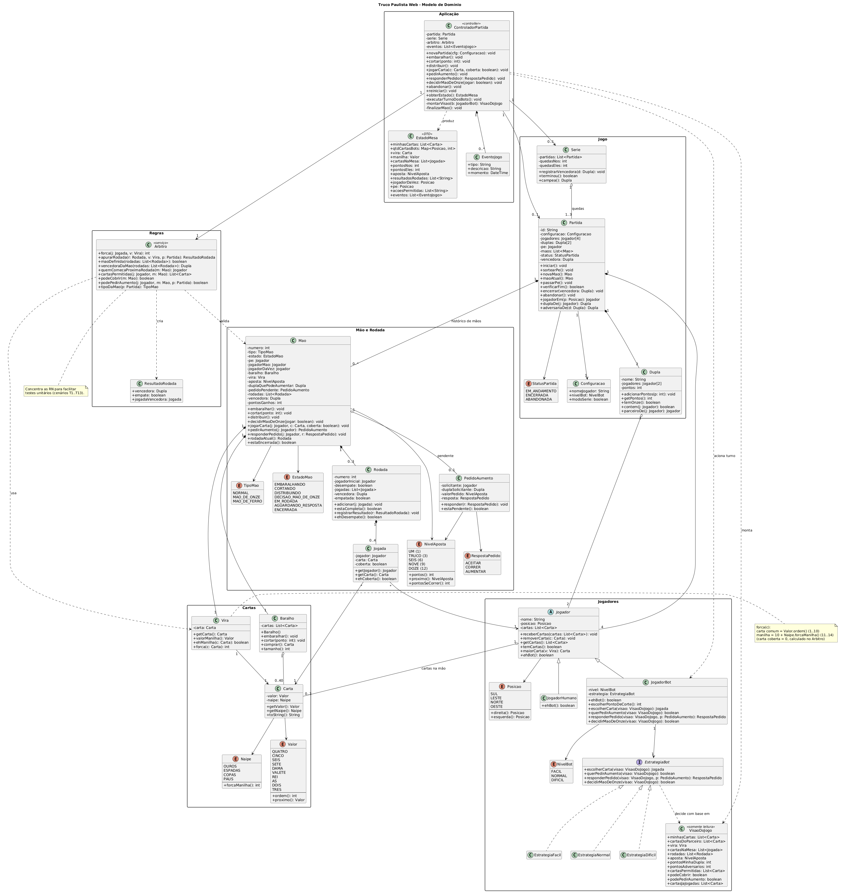

# Truco Paulista Web — Diagrama de Classes (Modelo de Domínio)

> Derivado de [casos-de-uso.md](casos-de-uso.md). Os IDs **UCxx** e **RNxx** citados aqui são os mesmos daquele documento.

---

## 1. Visão geral

O modelo é dividido em 6 pacotes:

| Pacote | Responsabilidade | Classes |
|---|---|---|
| **Cartas** | Baralho de 40 cartas e força das cartas | `Naipe`, `Valor`, `Carta`, `Baralho`, `Vira` |
| **Jogadores** | Quem joga e como os bots decidem | `Posicao`, `Jogador`, `JogadorHumano`, `JogadorBot`, `NivelBot`, `EstrategiaBot` (+3 implementações), `VisaoDoJogo` |
| **Jogo** | Duplas, placar e ciclo de mãos | `Partida`, `Dupla`, `StatusPartida`, `Configuracao`, `Serie` |
| **Mão e Rodada** | Estado de uma mão em andamento | `Mao`, `Rodada`, `Jogada`, `PedidoAumento`, `TipoMao`, `EstadoMao`, `NivelAposta`, `RespostaPedido` |
| **Regras** | Todas as regras de negócio em um só lugar | `Arbitro`, `ResultadoRodada` |
| **Aplicação** | Ponte entre a tela web e o domínio | `ControladorPartida`, `EstadoMesa`, `EventoJogo` |

---

## 2. Diagrama (PlantUML)

```plantuml
@startuml
skinparam classAttributeIconSize 0
skinparam packageStyle rectangle
hide empty members
title Truco Paulista Web - Modelo de Domínio

' ===================== CARTAS =====================
package "Cartas" {
  enum Naipe {
    OUROS
    ESPADAS
    COPAS
    PAUS
    --
    +forcaManilha(): int
  }

  enum Valor {
    QUATRO
    CINCO
    SEIS
    SETE
    DAMA
    VALETE
    REI
    AS
    DOIS
    TRES
    --
    +ordem(): int
    +proximo(): Valor
  }

  class Carta {
    -valor: Valor
    -naipe: Naipe
    +getValor(): Valor
    +getNaipe(): Naipe
    +toString(): String
  }

  class Baralho {
    -cartas: List<Carta>
    +Baralho()
    +embaralhar(): void
    +cortar(ponto: int): void
    +comprar(): Carta
    +tamanho(): int
  }

  class Vira {
    -carta: Carta
    +getCarta(): Carta
    +valorManilha(): Valor
    +ehManilha(c: Carta): boolean
    +forca(c: Carta): int
  }
}

' ===================== JOGADORES =====================
package "Jogadores" {
  enum Posicao {
    SUL
    LESTE
    NORTE
    OESTE
    --
    +direita(): Posicao
    +esquerda(): Posicao
  }

  enum NivelBot {
    FACIL
    NORMAL
    DIFICIL
  }

  abstract class Jogador {
    -nome: String
    -posicao: Posicao
    -cartas: List<Carta>
    +receberCartas(cartas: List<Carta>): void
    +removerCarta(c: Carta): void
    +getCartas(): List<Carta>
    +temCartas(): boolean
    +maiorCarta(v: Vira): Carta
    +{abstract} ehBot(): boolean
  }

  class JogadorHumano {
    +ehBot(): boolean
  }

  class JogadorBot {
    -nivel: NivelBot
    -estrategia: EstrategiaBot
    +ehBot(): boolean
    +escolherPontoDeCorte(): int
    +escolherCarta(visao: VisaoDoJogo): Jogada
    +querPedirAumento(visao: VisaoDoJogo): boolean
    +responderPedido(visao: VisaoDoJogo, p: PedidoAumento): RespostaPedido
    +decidirMaoDeOnze(visao: VisaoDoJogo): boolean
  }

  interface EstrategiaBot {
    +escolherCarta(visao: VisaoDoJogo): Jogada
    +querPedirAumento(visao: VisaoDoJogo): boolean
    +responderPedido(visao: VisaoDoJogo, p: PedidoAumento): RespostaPedido
    +decidirMaoDeOnze(visao: VisaoDoJogo): boolean
  }

  class EstrategiaFacil
  class EstrategiaNormal
  class EstrategiaDificil

  class VisaoDoJogo <<somente leitura>> {
    +minhasCartas: List<Carta>
    +cartasDoParceiro: List<Carta>
    +vira: Vira
    +cartasNaMesa: List<Jogada>
    +rodadas: List<Rodada>
    +aposta: NivelAposta
    +pontosMinhaDupla: int
    +pontosAdversarios: int
    +cartasPermitidas: List<Carta>
    +podeCobrir: boolean
    +podePedirAumento: boolean
    +cartasJaJogadas: List<Carta>
  }
}

' ===================== JOGO =====================
package "Jogo" {
  enum StatusPartida {
    EM_ANDAMENTO
    ENCERRADA
    ABANDONADA
  }

  class Configuracao {
    +nomeJogador: String
    +nivelBot: NivelBot
    +modoSerie: boolean
  }

  class Dupla {
    -nome: String
    -jogadores: Jogador[2]
    -pontos: int
    +adicionarPontos(p: int): void
    +getPontos(): int
    +temOnze(): boolean
    +contem(j: Jogador): boolean
    +parceiroDe(j: Jogador): Jogador
  }

  class Partida {
    -id: String
    -configuracao: Configuracao
    -jogadores: Jogador[4]
    -duplas: Dupla[2]
    -pe: Jogador
    -maos: List<Mao>
    -status: StatusPartida
    -vencedora: Dupla
    +iniciar(): void
    +sortearPe(): void
    +novaMao(): Mao
    +maoAtual(): Mao
    +passarPe(): void
    +verificarFim(): boolean
    +encerrar(vencedora: Dupla): void
    +abandonar(): void
    +jogadorEm(p: Posicao): Jogador
    +duplaDe(j: Jogador): Dupla
    +adversariaDe(d: Dupla): Dupla
  }

  class Serie {
    -partidas: List<Partida>
    -quedasNos: int
    -quedasEles: int
    +registrarVencedora(d: Dupla): void
    +terminou(): boolean
    +campea(): Dupla
  }
}

' ===================== MÃO E RODADA =====================
package "Mão e Rodada" {
  enum TipoMao {
    NORMAL
    MAO_DE_ONZE
    MAO_DE_FERRO
  }

  enum EstadoMao {
    EMBARALHANDO
    CORTANDO
    DISTRIBUINDO
    DECISAO_MAO_DE_ONZE
    EM_RODADA
    AGUARDANDO_RESPOSTA
    ENCERRADA
  }

  enum NivelAposta {
    UM (1)
    TRUCO (3)
    SEIS (6)
    NOVE (9)
    DOZE (12)
    --
    +pontos(): int
    +proximo(): NivelAposta
    +pontosSeCorrer(): int
  }

  enum RespostaPedido {
    ACEITAR
    CORRER
    AUMENTAR
  }

  class Mao {
    -numero: int
    -tipo: TipoMao
    -estado: EstadoMao
    -pe: Jogador
    -jogadorMao: Jogador
    -jogadorDaVez: Jogador
    -baralho: Baralho
    -vira: Vira
    -aposta: NivelAposta
    -duplaQuePodeAumentar: Dupla
    -pedidoPendente: PedidoAumento
    -rodadas: List<Rodada>
    -vencedora: Dupla
    -pontosGanhos: int
    +embaralhar(): void
    +cortar(ponto: int): void
    +distribuir(): void
    +decidirMaoDeOnze(jogar: boolean): void
    +jogarCarta(j: Jogador, c: Carta, coberta: boolean): void
    +pedirAumento(j: Jogador): PedidoAumento
    +responderPedido(j: Jogador, r: RespostaPedido): void
    +rodadaAtual(): Rodada
    +estaEncerrada(): boolean
  }

  class Rodada {
    -numero: int
    -jogadorInicial: Jogador
    -desempate: boolean
    -jogadas: List<Jogada>
    -vencedora: Dupla
    -empatada: boolean
    +adicionar(j: Jogada): void
    +estaCompleta(): boolean
    +registrarResultado(r: ResultadoRodada): void
    +ehDesempate(): boolean
  }

  class Jogada {
    -jogador: Jogador
    -carta: Carta
    -coberta: boolean
    +getJogador(): Jogador
    +getCarta(): Carta
    +ehCoberta(): boolean
  }

  class PedidoAumento {
    -solicitante: Jogador
    -duplaSolicitante: Dupla
    -valorPedido: NivelAposta
    -resposta: RespostaPedido
    +responder(r: RespostaPedido): void
    +estaPendente(): boolean
  }
}

' ===================== REGRAS =====================
package "Regras" {
  class Arbitro <<serviço>> {
    +forca(j: Jogada, v: Vira): int
    +apurarRodada(r: Rodada, v: Vira, p: Partida): ResultadoRodada
    +maoDefinida(rodadas: List<Rodada>): boolean
    +vencedoraDaMao(rodadas: List<Rodada>): Dupla
    +quemComecaProximaRodada(m: Mao): Jogador
    +cartasPermitidas(j: Jogador, m: Mao): List<Carta>
    +podeCobrir(m: Mao): boolean
    +podePedirAumento(j: Jogador, m: Mao, p: Partida): boolean
    +tipoDaMao(p: Partida): TipoMao
  }

  class ResultadoRodada {
    +vencedora: Dupla
    +empate: boolean
    +jogadaVencedora: Jogada
  }
}

' ===================== APLICAÇÃO =====================
package "Aplicação" {
  class ControladorPartida <<controller>> {
    -partida: Partida
    -serie: Serie
    -arbitro: Arbitro
    -eventos: List<EventoJogo>
    +novaPartida(cfg: Configuracao): void
    +embaralhar(): void
    +cortar(ponto: int): void
    +distribuir(): void
    +jogarCarta(c: Carta, coberta: boolean): void
    +pedirAumento(): void
    +responderPedido(r: RespostaPedido): void
    +decidirMaoDeOnze(jogar: boolean): void
    +abandonar(): void
    +reiniciar(): void
    +obterEstado(): EstadoMesa
    -executarTurnoDosBots(): void
    -montarVisao(b: JogadorBot): VisaoDoJogo
    -finalizarMao(): void
  }

  class EstadoMesa <<DTO>> {
    +minhasCartas: List<Carta>
    +qtdCartasBots: Map<Posicao, int>
    +vira: Carta
    +manilha: Valor
    +cartasNaMesa: List<Jogada>
    +pontosNos: int
    +pontosEles: int
    +aposta: NivelAposta
    +resultadosRodadas: List<String>
    +jogadorDaVez: Posicao
    +pe: Posicao
    +acoesPermitidas: List<String>
    +eventos: List<EventoJogo>
  }

  class EventoJogo {
    +tipo: String
    +descricao: String
    +momento: DateTime
  }
}

' ===================== RELACIONAMENTOS =====================
Carta --> Valor
Carta --> Naipe
Baralho "1" o-- "0..40" Carta
Vira "1" --> "1" Carta

Jogador <|-- JogadorHumano
Jogador <|-- JogadorBot
Jogador --> Posicao
Jogador "1" o-- "0..3" Carta : cartas na mão
JogadorBot --> NivelBot
JogadorBot "1" --> "1" EstrategiaBot
EstrategiaBot <|.. EstrategiaFacil
EstrategiaBot <|.. EstrategiaNormal
EstrategiaBot <|.. EstrategiaDificil
EstrategiaBot ..> VisaoDoJogo : decide com base em

Partida "1" --> "1" Configuracao
Partida "1" *-- "4" Jogador
Partida "1" *-- "2" Dupla
Dupla "1" o-- "2" Jogador
Partida "1" *-- "0..*" Mao : histórico de mãos
Partida --> StatusPartida
Serie "1" o-- "1..3" Partida : quedas

Mao "1" *-- "1" Baralho
Mao "1" *-- "1" Vira
Mao "1" *-- "0..3" Rodada
Mao "1" o-- "0..1" PedidoAumento : pendente
Mao --> TipoMao
Mao --> EstadoMao
Mao --> NivelAposta
Rodada "1" *-- "0..4" Jogada
Jogada "*" --> "1" Jogador
Jogada "*" --> "1" Carta
PedidoAumento --> NivelAposta
PedidoAumento --> RespostaPedido

Arbitro ..> ResultadoRodada : cria
Arbitro ..> Mao : valida
Arbitro ..> Vira : usa

ControladorPartida "1" --> "0..1" Partida
ControladorPartida "1" --> "0..1" Serie
ControladorPartida "1" --> "1" Arbitro
ControladorPartida "1" *-- "0..*" EventoJogo
ControladorPartida ..> EstadoMesa : produz
ControladorPartida ..> VisaoDoJogo : monta
ControladorPartida ..> JogadorBot : aciona turno

note right of Vira
  forca(c):
  carta comum = Valor.ordem() (1..10)
  manilha = 10 + Naipe.forcaManilha() (11..14)
  (carta coberta = 0, calculado no Arbitro)
end note

note bottom of Arbitro
  Concentra as RN para facilitar
  testes unitários (cenários T1..T13).
end note
@enduml
```

> Imagem também em vetor: [diagrama-de-classes.svg](diagrama-de-classes.svg). Para editar, altere o código abaixo e gere de novo em <https://www.plantuml.com/plantuml> ou com a extensão **PlantUML** do VS Code (Alt+D).

---

## 3. Descrição das classes

### 3.1 Pacote Cartas

| Classe | Descrição | Regras |
|---|---|---|
| `Naipe` (enum) | Os 4 naipes. `forcaManilha()` devolve Ouros = 1, Espadas = 2, Copas = 3 e Paus = 4. | RN04 |
| `Valor` (enum) | Os 10 valores em ordem crescente de força. `ordem()` devolve 1 (QUATRO) a 10 (TRES). `proximo()` é **circular**: TRES → QUATRO. | RN02, RN03 |
| `Carta` | Objeto de valor (imutável) com um `Valor` e um `Naipe`. | RN01 |
| `Baralho` | O construtor cria as 40 cartas. Tem as operações de embaralhar, cortar e comprar. `cortar(ponto)` aceita pontos de 1 a 39. | RN01, RN06 |
| `Vira` | Guarda a carta virada. Calcula qual valor é manilha e a força de qualquer carta na mão atual. | RN03, RN04 |

### 3.2 Pacote Jogadores

| Classe | Descrição | Regras |
|---|---|---|
| `Posicao` (enum) | SUL, LESTE, NORTE e OESTE. `direita()` dá o próximo jogador no sentido anti-horário (SUL → LESTE). `esquerda()` dá o anterior. | RN05, RN06, RN08 |
| `Jogador` (abstrata) | Nome, posição e as cartas que tem na mão. `maiorCarta(vira)` atende a rodada de desempate. | RN21 |
| `JogadorHumano` | Representa o usuário. As decisões dele chegam pela tela, através do `ControladorPartida`. | RN20 |
| `JogadorBot` | Repassa as decisões para a sua `EstrategiaBot`. | — |
| `EstrategiaBot` (interface) | Padrão **Strategy**: cada nível de dificuldade é uma implementação. | — |
| `EstrategiaFacil` / `Normal` / `Dificil` | Heurísticas descritas no UC16, passo 3. | — |
| `VisaoDoJogo` | "Fotografia" **só com o que o bot pode ver**. As cartas do parceiro só aparecem na mão de onze. Isso impede que o bot trapaceie. | RN17 |

### 3.3 Pacote Jogo

| Classe | Descrição | Regras |
|---|---|---|
| `Partida` | Raiz do jogo: os 4 jogadores, as 2 duplas, o pé atual, as mãos jogadas e a dupla vencedora. | RN08, RN19 |
| `Dupla` | "Nós" ou "Eles", com 2 jogadores e o placar. `temOnze()` é usado para identificar mão de onze e mão de ferro. | RN17, RN18 |
| `Configuracao` | Dados informados no UC01. | — |
| `StatusPartida` (enum) | Em andamento, encerrada ou abandonada. | — |
| `Serie` | Melhor de 3 quedas. É opcional. | — |

### 3.4 Pacote Mão e Rodada

| Classe | Descrição | Regras |
|---|---|---|
| `Mao` | Estado completo de uma mão: tipo, estado atual, pé, jogador mão, vez, vira, valor da aposta, quem pode aumentar, pedido pendente e rodadas. | RN07, RN09, RN13, RN14 |
| `Rodada` | Até 4 jogadas. O atributo `desempate` indica se a rodada veio depois de um empate. | RN10, RN21 |
| `Jogada` | Uma carta jogada por um jogador, que pode ser coberta. | RN16 |
| `PedidoAumento` | Um pedido de Truco, Seis, Nove ou Doze e a resposta a ele. | RN14, RN15 |
| `NivelAposta` (enum) | Os valores 1, 3, 6, 9 e 12. `pontosSeCorrer()` devolve o valor anterior: 1, 3, 6 ou 9. | RN13, RN15 |
| `TipoMao` (enum) | Normal, mão de onze ou mão de ferro. | RN17, RN18 |
| `EstadoMao` (enum) | Em que fase a mão está. Fica pronto para o diagrama de estados. | — |
| `RespostaPedido` (enum) | Aceitar, correr ou aumentar. | RN15 |

### 3.5 Pacote Regras

| Método do `Arbitro` | O que faz | Regras |
|---|---|---|
| `forca(jogada, vira)` | Calcula a força da carta: 0 se coberta, 1 a 10 se comum, 11 a 14 se manilha. | RN02, RN04, RN16 |
| `apurarRodada(...)` | Define a dupla vencedora da rodada ou o empate. Se a maior carta for de parceiros, a rodada é da dupla. | RN10 |
| `maoDefinida(rodadas)` | Diz se a mão já tem vencedor ou empate definitivo. | RN11, RN12 |
| `vencedoraDaMao(rodadas)` | Aplica a tabela de desempate. | RN11 |
| `quemComecaProximaRodada(mao)` | Se a rodada anterior teve vencedor, começa quem venceu. Se empatou, começa o **pé**. | RN09, RN21 |
| `cartasPermitidas(jogador, mao)` | Devolve todas as cartas do jogador. Na rodada de desempate, devolve só a(s) mais forte(s). | RN21 |
| `podeCobrir(mao)` | Só a partir da 2ª rodada, e nunca na rodada de desempate nem na mão de ferro. | RN16, RN18, RN21 |
| `podePedirAumento(jogador, mao, partida)` | Precisa ser a vez do jogador, a dupla dele precisa poder aumentar, a aposta precisa ser menor que 12 e a mão não pode ser de onze nem de ferro. | RN14, RN17, RN18 |
| `tipoDaMao(partida)` | Uma dupla com 11 → MAO_DE_ONZE. As duas com 11 → MAO_DE_FERRO. | RN17, RN18 |

### 3.6 Pacote Aplicação

| Classe | Descrição |
|---|---|
| `ControladorPartida` | Único ponto de entrada da interface web. Cada método público corresponde a uma ação do jogador. Depois de cada ação, `executarTurnoDosBots()` faz os bots jogarem até chegar de novo a vez do humano. O bot usa **os mesmos métodos** que o humano (UC16, passo 5). `finalizarMao()` soma os pontos da mão encerrada ao placar da dupla vencedora (UC14). |
| `EstadoMesa` | Objeto de transferência (DTO) com tudo que a tela precisa desenhar (UC17). Nunca leva as cartas dos bots, só a quantidade de cartas de cada um. |
| `EventoJogo` | Linha do histórico da mesa, por exemplo "Leste pediu truco" ou "Empachou! Mostrem a maior". |

---

## 4. Rastreabilidade: caso de uso → classes e métodos

| UC | Caso de uso | Onde acontece |
|---|---|---|
| UC01 | Iniciar Partida | `ControladorPartida.novaPartida()` → `Partida.iniciar()`, `Partida.sortearPe()` |
| UC02 | Jogar Partida | `Partida.novaMao()`, `Partida.verificarFim()`, `Partida.passarPe()` |
| UC03 | Embaralhar e Distribuir | `Mao.embaralhar()` → `Baralho.embaralhar()`; `Mao.distribuir()` → `Jogador.receberCartas()` |
| UC04 | Cortar Baralho | `Mao.cortar()` → `Baralho.cortar()`; bot: `JogadorBot.escolherPontoDeCorte()` |
| UC05 | Definir Vira e Manilhas | `Vira.valorManilha()`, `Vira.ehManilha()` |
| UC06 | Disputar Mão | `Mao` (estados), `Arbitro.maoDefinida()`, `Arbitro.vencedoraDaMao()` |
| UC07 | Jogar Carta | `ControladorPartida.jogarCarta()` → `Mao.jogarCarta()` → `Rodada.adicionar()`; validação: `Arbitro.cartasPermitidas()` |
| UC08 | Jogar Carta Coberta | `Jogada.coberta = true`; validação: `Arbitro.podeCobrir()` |
| UC09 | Apurar Rodada | `Arbitro.apurarRodada()` → `ResultadoRodada`; `Arbitro.quemComecaProximaRodada()` |
| UC10 | Pedir Truco | `Mao.pedirAumento()` → `PedidoAumento`; validação: `Arbitro.podePedirAumento()` |
| UC11 | Responder Pedido | `Mao.responderPedido()` → `PedidoAumento.responder()`, `NivelAposta.pontosSeCorrer()` |
| UC12 | Decidir Mão de Onze | `Mao.decidirMaoDeOnze()`; bot: `JogadorBot.decidirMaoDeOnze()` com `VisaoDoJogo.cartasDoParceiro` |
| UC13 | Jogar Mão de Ferro | `Arbitro.tipoDaMao()` = MAO_DE_FERRO; `Mao.tipo` |
| UC14 | Marcar Pontos | `Dupla.adicionarPontos()`, `Mao.pontosGanhos` |
| UC15 | Encerrar Partida | `Partida.verificarFim()`, `Partida.encerrar()` |
| UC16 | Executar Turno do Bot | `ControladorPartida.executarTurnoDosBots()`, `montarVisao()`, `EstrategiaBot` |
| UC17 | Visualizar Mesa | `ControladorPartida.obterEstado()` → `EstadoMesa`, `EventoJogo` |
| UC18 | Consultar Regras | Conteúdo estático da interface (sem classe de domínio) |
| UC19 | Abandonar / Reiniciar | `ControladorPartida.abandonar()` / `reiniciar()` → `Partida.abandonar()` |
| UC20 | Série em Quedas | `Serie.registrarVencedora()`, `Serie.campea()` |

---

## 5. Decisões de projeto

1. **`Arbitro` separado das entidades.** As entidades (`Mao`, `Rodada`) guardam **estado** e o `Arbitro` concentra as **regras**. Assim cada regra pode ser testada sozinha (cenários T1 a T13 do documento de casos de uso).
2. **Strategy para os bots.** Trocar a dificuldade significa trocar a estratégia, sem mexer no `JogadorBot`.
3. **`VisaoDoJogo` para os bots e `EstadoMesa` para a tela.** Nenhum dos dois expõe informação escondida, então nem a tela nem o bot conseguem "ver" cartas que não deveriam.
4. **`Mao` como agregado.** Toda alteração na mão passa pelos métodos de `Mao`, que verifica o `EstadoMao`. Isso impede, por exemplo, jogar carta com um pedido de truco pendente (UC07, FE2).
5. **Humano e bot pelo mesmo caminho.** Os dois agem pelo `ControladorPartida`, então as validações são as mesmas para todos.
