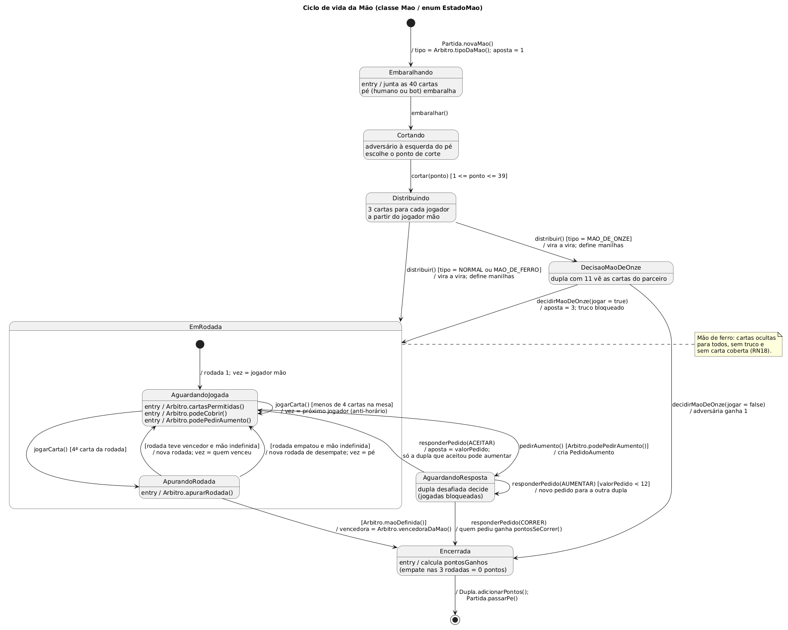
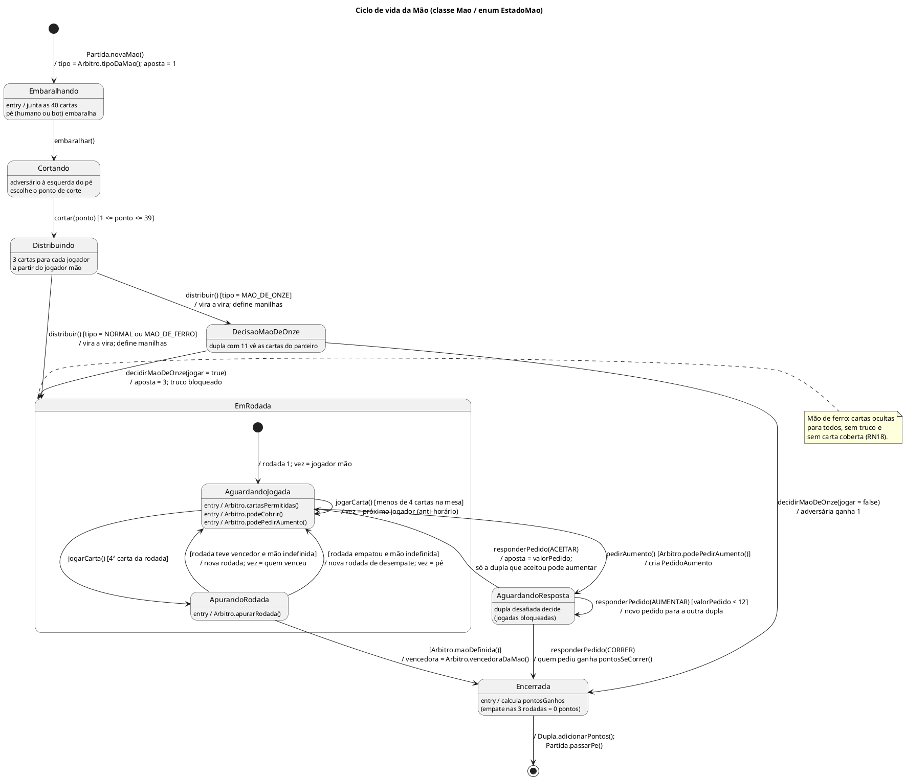
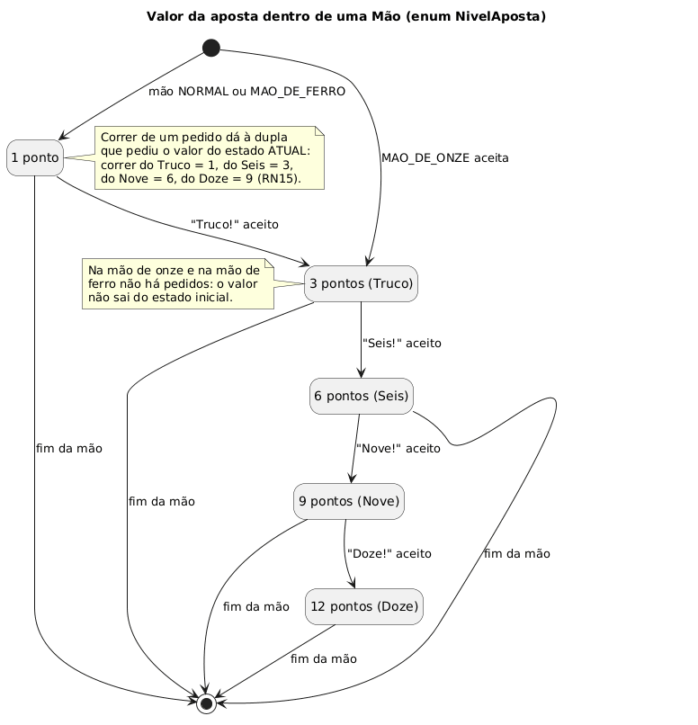
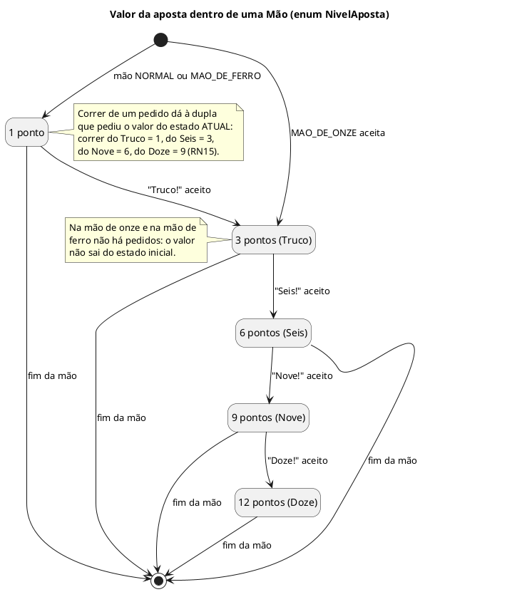

# Truco Paulista Web — Diagrama de Estados da Mão

> Deriva de [casos-de-uso.md](casos-de-uso.md) e [diagrama-de-classes.md](diagrama-de-classes.md).
> Modela o ciclo de vida de um objeto `Mao`, cujo atributo `estado` é do tipo `EstadoMao`.

**Como ler as setas:** `evento [guarda] / ação`
- **evento:** o método do `ControladorPartida`/`Mao` que dispara a mudança.
- **[guarda]:** a condição que precisa ser verdadeira para a transição acontecer.
- **/ ação:** o que o sistema faz durante a transição.

---

## 1. Diagrama principal — ciclo de vida da Mão

---

## 2. Estados

| Estado no diagrama | `EstadoMao` | O que acontece | Ações liberadas na tela | UC |
|---|---|---|---|---|
| **Embaralhando** | `EMBARALHANDO` | O pé junta e embaralha as 40 cartas. | "Embaralhar" (só se o pé for o humano) | UC03 |
| **Cortando** | `CORTANDO` | O adversário à esquerda do pé escolhe onde cortar. | Escolher o ponto de corte (só se o cortador for o humano) | UC04 |
| **Distribuindo** | `DISTRIBUINDO` | O pé dá 3 cartas a cada jogador e vira a vira. | "Distribuir" (só se o pé for o humano) | UC03, UC05 |
| **DecisaoMaoDeOnze** | `DECISAO_MAO_DE_ONZE` | A dupla com 11 pontos vê as cartas do parceiro e decide. | "Jogar" / "Correr" (se a dupla com 11 for a do humano) | UC12 |
| **EmRodada** (composto) | `EM_RODADA` | As rodadas estão sendo jogadas. | — | UC06 |
| ↳ **AguardandoJogada** | `EM_RODADA` | O jogador da vez escolhe uma carta. | Jogar carta, cobrir carta e pedir truco, conforme o `Arbitro` permitir | UC07, UC08, UC10 |
| ↳ **ApurandoRodada** | `EM_RODADA` | Estado **transitório**: o sistema compara as 4 cartas e decide se a mão acabou. | Nenhuma | UC09 |
| **AguardandoResposta** | `AGUARDANDO_RESPOSTA` | Há um pedido de Truco, Seis, Nove ou Doze pendente. | "Aceitar" / "Correr" / "Aumentar" (se a dupla desafiada for a do humano) | UC11 |
| **Encerrada** | `ENCERRADA` | O vencedor está definido e os pontos são somados ao placar. | Nenhuma (a próxima mão começa) | UC14 |

> **AguardandoJogada** e **ApurandoRodada** são subestados de `EM_RODADA`. Não precisam virar valores do enum: o sistema sabe em qual dos dois está pela quantidade de cartas na mesa da `Rodada` atual.

---

## 3. Transições

| # | De → Para | Evento | Guarda | Ação | Regras |
|---|---|---|---|---|---|
| T01 | início → Embaralhando | `Partida.novaMao()` | — | Define o tipo da mão. Aposta = 1. | RN17, RN18 |
| T02 | Embaralhando → Cortando | `embaralhar()` | Quem age é o pé | Embaralha o baralho. | RN06 |
| T03 | Cortando → Distribuindo | `cortar(ponto)` | Ponto entre 1 e 39; quem age é o cortador | Corta o monte. | RN06 |
| T04 | Distribuindo → DecisaoMaoDeOnze | `distribuir()` | `tipo = MAO_DE_ONZE` | Dá 3 cartas a cada jogador, vira a vira e define as manilhas. | RN03, RN07, RN17 |
| T05 | Distribuindo → EmRodada | `distribuir()` | `tipo = NORMAL` ou `MAO_DE_FERRO` | Igual à T04. Na mão de ferro, as cartas ficam ocultas. | RN07, RN18 |
| T06 | DecisaoMaoDeOnze → EmRodada | `decidirMaoDeOnze(true)` | — | Aposta = 3. Truco bloqueado. | RN17 |
| T07 | DecisaoMaoDeOnze → Encerrada | `decidirMaoDeOnze(false)` | — | A dupla adversária ganha 1 ponto. | RN17 |
| T08 | AguardandoJogada → AguardandoJogada | `jogarCarta()` | Carta permitida; ainda há menos de 4 cartas na mesa | Coloca a carta na mesa e passa a vez em sentido anti-horário. | RN05, RN16, RN21 |
| T09 | AguardandoJogada → ApurandoRodada | `jogarCarta()` | É a 4ª carta da rodada | — | — |
| T10 | ApurandoRodada → AguardandoJogada | (automática) | A rodada teve vencedor e a mão não está definida | Cria a próxima rodada. Começa quem venceu. | RN09 |
| T11 | ApurandoRodada → AguardandoJogada | (automática) | A rodada empatou e a mão não está definida | Cria a próxima rodada com `desempate = true`. Começa o **pé**. | RN09, RN21 |
| T12 | ApurandoRodada → Encerrada | (automática) | `Arbitro.maoDefinida()` | Define a dupla vencedora, ou nenhuma se as 3 rodadas empataram. | RN11, RN12 |
| T13 | AguardandoJogada → AguardandoResposta | `pedirAumento()` | `Arbitro.podePedirAumento()` | Cria um `PedidoAumento`. | RN14 |
| T14 | AguardandoResposta → AguardandoResposta | `responderPedido(AUMENTAR)` | Valor pedido menor que 12 | Cria um novo pedido no sentido contrário. | RN13, RN14 |
| T15 | AguardandoResposta → AguardandoJogada | `responderPedido(ACEITAR)` | — | Aposta = valor pedido. Só a dupla que aceitou pode pedir o próximo aumento. A vez volta para o jogador que estava jogando. | RN13, RN14 |
| T16 | AguardandoResposta → Encerrada | `responderPedido(CORRER)` | — | A dupla que pediu ganha `pontosSeCorrer()`. | RN15 |
| T17 | Encerrada → fim | (automática) | — | Soma os pontos ao placar e passa o pé. A `Partida` verifica se chegou a 12 ou cria a próxima mão. | RN08, RN19 |

### 3.1 Eventos fora de hora

Se um evento chega num estado em que não há transição para ele, a `Mao` **recusa** o evento e o estado não muda. É assim que o diagrama implementa os fluxos de exceção dos casos de uso:

| Evento recusado | Estado em que chegou | Mensagem na tela | UC |
|---|---|---|---|
| `jogarCarta()` | AguardandoResposta | "Responda o pedido de truco antes" | UC07 FE2 |
| `jogarCarta()` de quem não está na vez | AguardandoJogada | "Aguarde sua vez" | UC07 FE1 |
| `jogarCarta()` com carta não permitida | AguardandoJogada (rodada de desempate) | "Você deve mostrar sua maior carta" | UC07 FE3 |
| `pedirAumento()` | DecisaoMaoDeOnze, ou AguardandoJogada na mão de onze ou de ferro | Botão desabilitado | UC10 FE1 |
| `embaralhar()`, `cortar()` ou `distribuir()` | Qualquer estado fora do esperado | Ignorado | — |

---

## 4. Diagrama auxiliar — valor da aposta (`NivelAposta`)

---

## 5. Cenários percorridos no diagrama

| Cenário | Caminho de transições |
|---|---|
| Mão simples, Nós vencem 1ª e 2ª rodada | T01 → T02 → T03 → T05 → T08 ×3 → T09 → T10 → T08 ×3 → T09 → T12 → T17 |
| Empate na 1ª rodada, Eles vencem a 2ª | … T09 → **T11** (desempate, começa o pé) → T08 ×3 → T09 → T12 → T17 |
| Truco aceito, depois Seis e corrida | … T13 → T15 (aposta 3) … T13 → T16 (quem pediu Seis ganha 3) → T17 |
| Truco respondido com Seis, que é aceito | … T13 → T14 → T15 (aposta 6) … |
| Mão de onze, a dupla corre | T01 → T02 → T03 → T04 → T07 → T17 |
| Empate nas 3 rodadas | … T09 → T11 → … T09 → T11 → … T09 → T12 (0 pontos) → T17 |
