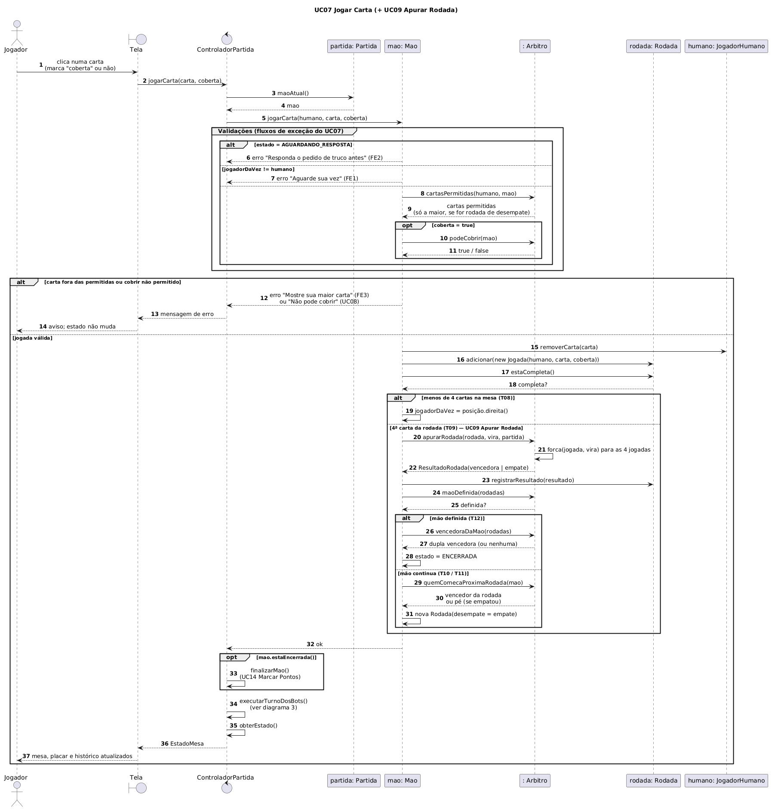
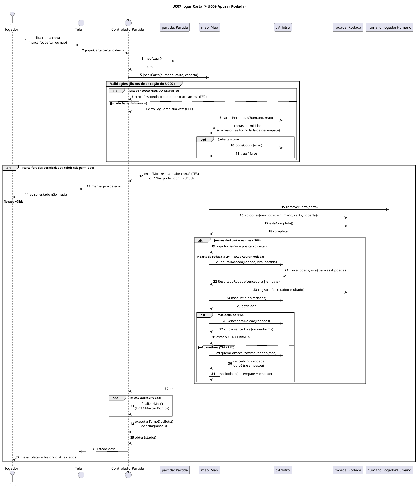
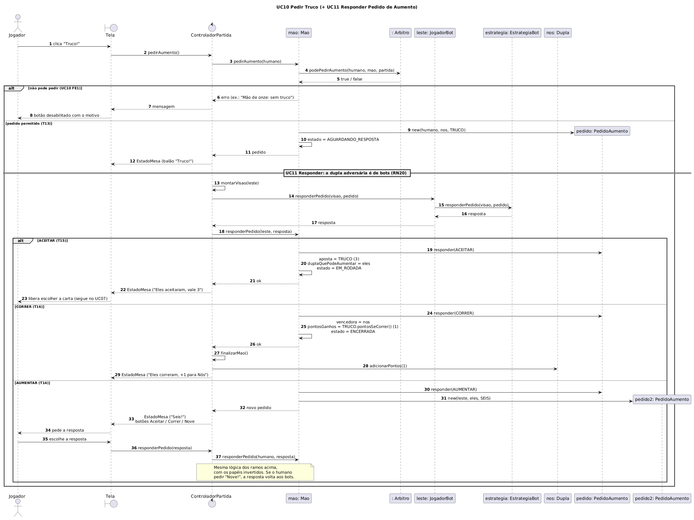
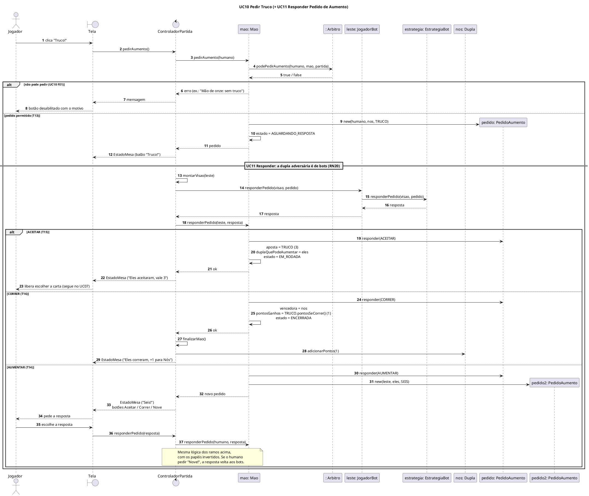
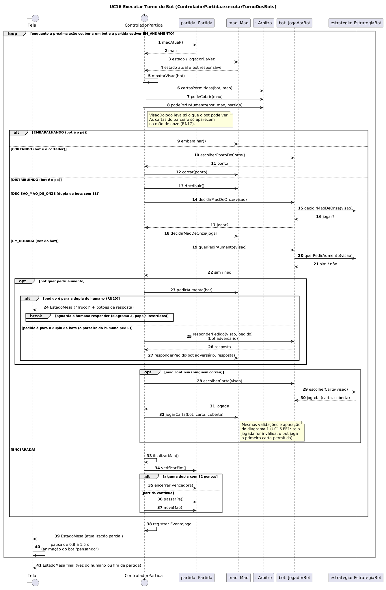
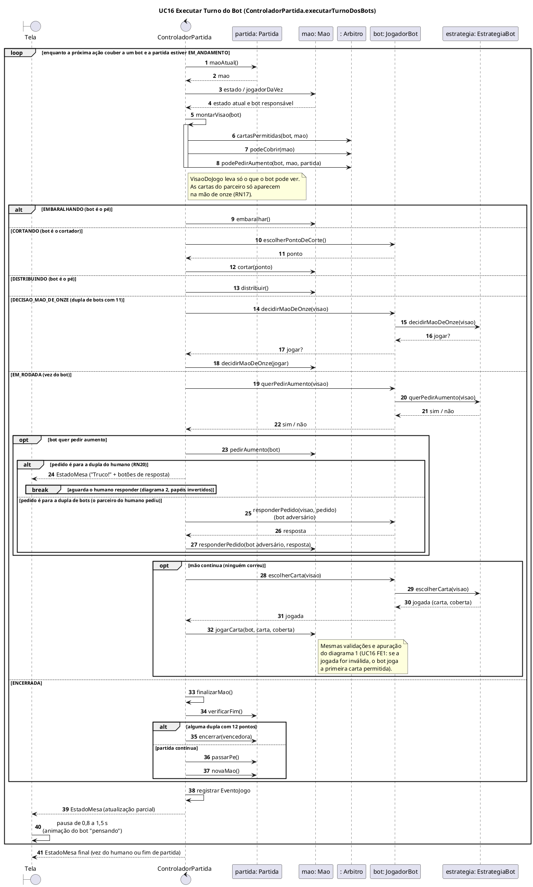

# Truco Paulista Web — Diagramas de Sequência

> Deriva de [casos-de-uso.md](casos-de-uso.md), [diagrama-de-classes.md](diagrama-de-classes.md) e [diagrama-de-estados.md](diagrama-de-estados.md).
> Todas as mensagens são métodos que existem no diagrama de classes, e as mudanças de `estado` seguem as transições T01 a T17 do diagrama de estados.

**Participantes**

| Participante | Papel |
|---|---|
| `Jogador` (ator) | O usuário humano |
| `Tela` (boundary) | Interface web: mostra o `EstadoMesa` e envia as ações do jogador |
| `ControladorPartida` (control) | Único ponto de entrada do domínio |
| `Partida`, `Mao`, `Rodada`, `Dupla`, `PedidoAumento` | Entidades do domínio |
| `Arbitro` | Serviço que concentra as regras de negócio |
| `JogadorBot` + `EstrategiaBot` | Decisão automática dos bots |

---

## 1. UC07 — Jogar Carta (inclui UC09 — Apurar Rodada)

**Como ler**
- O bloco **Validações** implementa os fluxos de exceção FE1, FE2 e FE3 do UC07 e o FE1 do UC08. Quando a jogada é recusada, a `Mao` não muda de estado.
- A **rodada de desempate** (RN21) aparece em dois pontos: em `cartasPermitidas()`, que devolve só a maior carta, e em `quemComecaProximaRodada()`, que devolve o pé.
- Depois da jogada do humano, o controlador chama `executarTurnoDosBots()`. Os bots jogam até chegar de novo a vez do humano, e só então a tela é atualizada.

---

## 2. UC10 — Pedir Truco (inclui UC11 — Responder Pedido)

Cenário: o **humano pede truco** e a **dupla de bots adversária** responde.

**Como ler**
- O pedido só é criado se `Arbitro.podePedirAumento()` permitir (RN14, RN17, RN18).
- **Quem responde pela dupla de bots:** o adversário à direita do humano (`leste`), que é o próximo na ordem. Pela RN20, quando o pedido é para a dupla do humano, **sempre o humano** responde, mesmo que quem esteja na vez seja o parceiro.
- `NivelAposta.pontosSeCorrer()` devolve o valor anterior ao pedido: correr do Truco dá 1, do Seis dá 3, e assim por diante (RN15).
- Ao aceitar, `duplaQuePodeAumentar` passa a ser a dupla que aceitou. A dupla que pediu fica impedida de pedir de novo em seguida.

---

## 3. UC16 — Executar Turno do Bot

Este é o laço que o controlador roda depois de cada ação do humano. Ele também roda no início de cada mão, quando o pé ou o cortador é um bot.

**Como ler**
- O laço avança a `Mao` pelo diagrama de estados **até a próxima ação caber ao humano**: a vez dele de jogar, a resposta a um pedido, a decisão da mão de onze ou embaralhar/cortar quando ele é o pé ou o cortador.
- O bot usa **os mesmos métodos da `Mao`** que o humano (`jogarCarta`, `pedirAumento`...). Por isso as validações são idênticas para todos (UC16, passo 5).
- O bloco `break` mostra a saída antecipada do laço: um bot pede truco para a dupla do humano, e o sistema precisa esperar a resposta dele.
- O ramo **ENCERRADA** cuida da troca de mão: marca os pontos (UC14), verifica o fim da partida (UC15) e passa o pé (RN08).

---

## 4. Conferência com o diagrama de classes

| Mensagem nos diagramas | Classe / método |
|---|---|
| `jogarCarta`, `pedirAumento`, `responderPedido`, `obterEstado`, `executarTurnoDosBots`, `montarVisao`, `finalizarMao` | `ControladorPartida` |
| `maoAtual`, `verificarFim`, `encerrar`, `passarPe`, `novaMao` | `Partida` |
| `jogarCarta`, `pedirAumento`, `responderPedido`, `embaralhar`, `cortar`, `distribuir`, `decidirMaoDeOnze` | `Mao` |
| `adicionar`, `estaCompleta`, `registrarResultado` | `Rodada` |
| `cartasPermitidas`, `podeCobrir`, `podePedirAumento`, `apurarRodada`, `forca`, `maoDefinida`, `vencedoraDaMao`, `quemComecaProximaRodada` | `Arbitro` |
| `escolherPontoDeCorte`, `escolherCarta`, `querPedirAumento`, `responderPedido`, `decidirMaoDeOnze` | `JogadorBot` / `EstrategiaBot` |
| `responder` | `PedidoAumento` |
| `adicionarPontos` | `Dupla` |
| `removerCarta` | `Jogador` |
